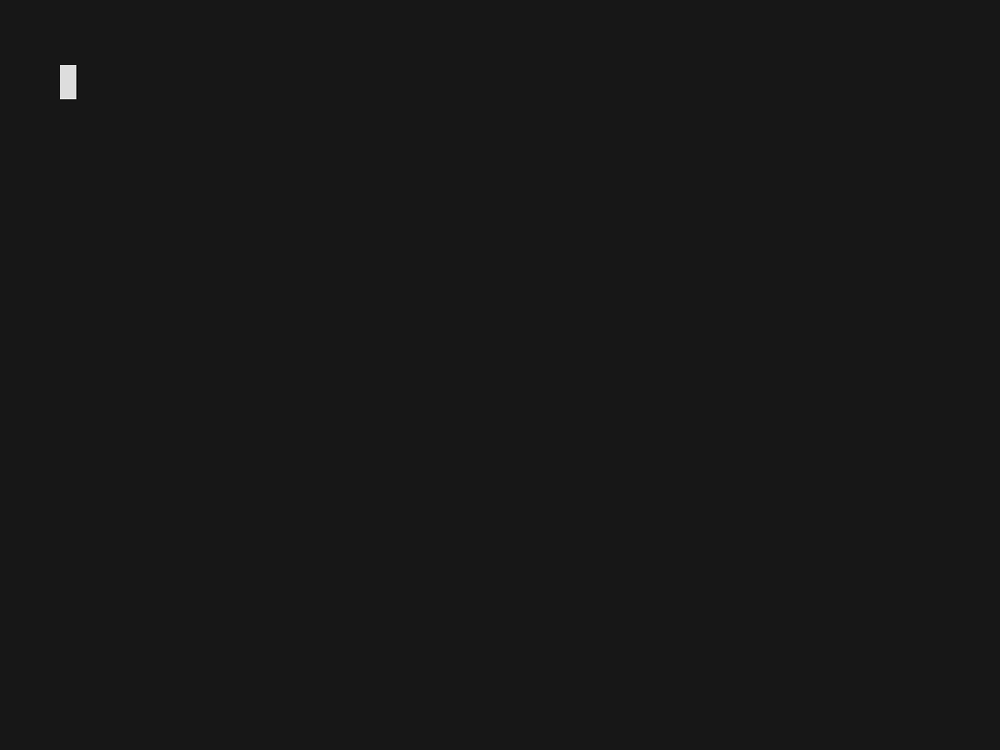
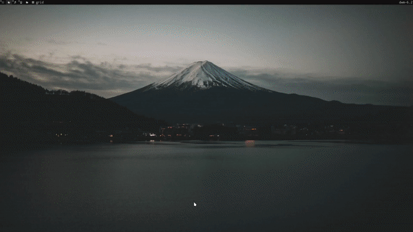
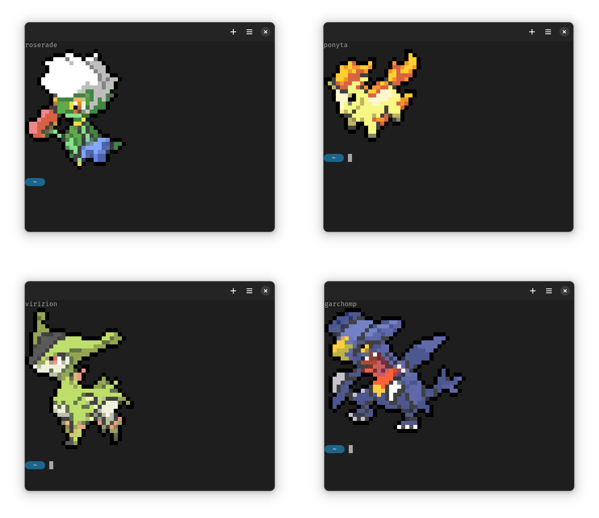
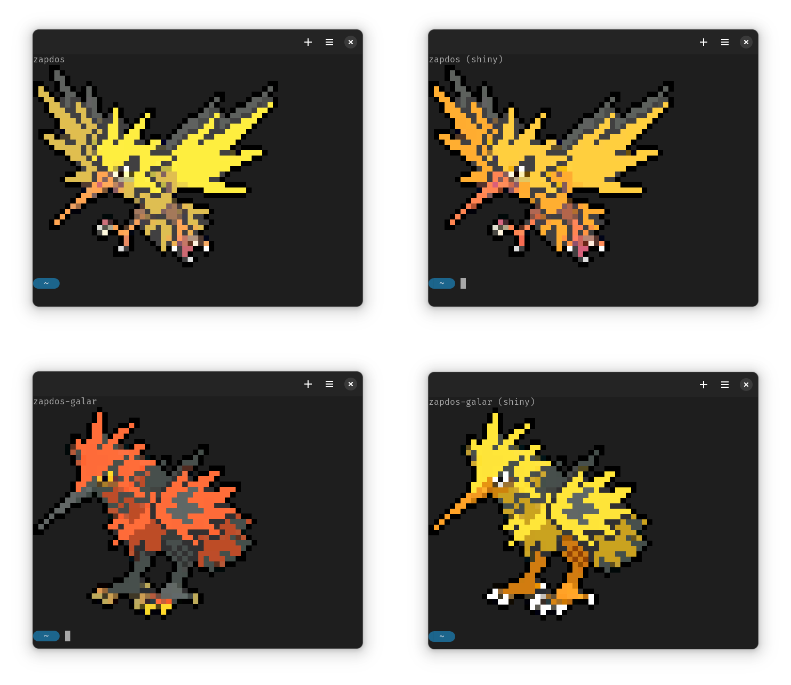

# Pokemon colorscripts

A script to print out images of pokemon to the terminal. Forked from
[Phoney badger's pokemon-colorscripts](https://gitlab.com/phoneybadger/pokemon-colorscripts)

## Table of contents
- [Description](#description)
- [Visuals](#visuals)
  - [Demo GIFs](#demo-gifs)
  - [Screenshots](#screenshots)
- [Requirements](#requirements)
- [Installation](#installation)
  - [On Arch or Arch based distros](#on-arch-or-arch-based-distros)
  - [On other distros and MacOS](#on-other-distros-and-macos)
  - [Uninstall](#uninstall)
- [Usage](#usage)
  - [Running on terminal startup](#running-on-terminal-startup)
    - [On Bash and ZSH](#on-bash-and-zsh)
    - [On Fish](#on-fish)
- [Location of the files](#location-of-the-files)
- [How it works](#how-it-works)
- [Similar projects](#similar-projects)
- [Credits](#credits)
- [Author](#author)
- [License](#license)

## Description
Prints out colored unicode sprites of pokemon onto your terminal. Contains
pokemon from generations 1 to 10, including shiny sprites and alternate forms, even some special forms for you to find.

## Visuals
### Demo GIFs
Demo of the program being used



Demo of the program running on terminal startup.



### Screenshots




## Requirements
The program requires `python3` to run and a terminal with true color support,
which most modern terminals have. More on terminals and color support can be found in
[this gist](https://gist.github.com/XVilka/8346728)

## Installation

### On Arch or Arch based distros
The utility is available as an AUR package
[pokemon-colorscripts-enhanced-git](https://aur.archlinux.org/packages/pokemon-colorscripts-enhanced-git).
You can install this manually or using an AUR helper. For manual installation,
download the PKGBUILD file from this repository. Then run
```
makepkg -cf
```
which will create a .pkg.tar.zst file. Then run
```
sudo pacman -U <filename.pkg.tar.zst>
```

Or you can use an AUR Helper such as yay and run
```
yay -S pokemon-colorscripts-enhanced-git
```

### On other distros and MacOS
Clone or download the repository
```
git clone https://github.com/lelnofake/pokemon-colorscripts-enhanced.git
```
`cd` into the directory and run the install script
```
cd pokemon-colorscripts
sudo ./install.sh
```
Now the program should be installed. You can check this by running
```
pokemon-colorscripts
```
Which should print out the help page for the program

### Uninstall
To uninstall the program you can run the uninstall script. Make the script
executable if it already isn't
```
chmod +x ./uninstall.sh
```
and run the script
```
sudo ./uninstall.sh
```

## Usage
You can run the program from the command line to either display a pokemon of your
choice by specifying the pokemon name or dex number or make it display a random pokemon.
```
pokemon-colorscripts [OPTION]...

Options:
  -h, --help             Show help
  -l, --list             List pokemon
  -n, --name NAME        Select a pokemon by name
  -d, --dex DEX          Select a pokemon by Pokedex number
      --daily            Show today's machine-specific pokemon
  -f, --form [FORM]      Select a form using an optional regular expression
  -r, --random [GEN]     Select a random pokemon, optionally by generation
  -s, --shiny            Show a shiny sprite
  -c, --compact          Show a smaller sprite
      --no-title         Do not display the pokemon name

NAME must match a name shown by --list. DEX is a Pokedex number 1-1028 as of 16-10-2026.
 Exactly one of --name, --dex, --random, or --daily may be used. With no target, the command prints help;
--form is the exception and implicitly selects a random pokemon.

FORM is a case-insensitive regular expression searched against form names.
With --name or --dex and a FORM value, an exact case-insensitive form name
takes precedence; otherwise, a matching form is selected at random. If there
is no match, that pokemon's forms are listed. With --random and a FORM value,
a random pokemon with a matching form is chosen, then one of its matching
forms is selected. With --name, --dex or --random and no FORM value, any form, including
regular, may be selected. With --form and no target, a random pokemon from generations
1-10 is selected; without FORM, any of its forms, including regular, may be
selected.
Random selections have a 1 in 128 chance of being shiny unless --shiny is
specified.

--daily selects the same pokemon, form, and shiny state throughout a day on
the same machine, based on the date and hostname. It has its own deterministic
1-in-128 shiny chance. It accepts --compact and --no-title, but not --list,
--form, or --shiny.

GEN may be a generation number, a range such as 1-3, or a comma-separated list
such as 1,3,6. Ranges are inclusive; if omitted, all generations (1-10) are
eligible. For a comma-separated list, one listed generation is chosen at
random, then a pokemon is chosen from that generation.

Form and list combinations:
  -n NAME -f              Select a random form of NAME, including regular
  -d DEX -f               Select a random form of the numbered pokemon
  -n NAME -f REGEX        Select an exact form match, or a random regex match
  -r [GEN] -f             Select a random form, including regular, from a pokemon with alternate forms
  -r [GEN] -f REGEX       Select a random form matching REGEX
  -l -f                   List all pokemon and all their forms
  -l -f REGEX             List pokemon with matching forms and all their forms
  -l -n NAME              List NAME and its forms
  -l -d DEX               List the numbered pokemon and its forms
  -l -r [GEN]             List a random pokemon with alternate forms

In list mode, -f is optional with -n, -d, or -r; without a value, it does not
change the result. A valued -f cannot be combined with -l -n, -l -d, or -l -r.
With -l -f REGEX, matching may include the regular form, and all forms of each
matching pokemon are listed. -l -r selects from pokemon that have alternate
forms, even when -f is omitted. --shiny, --compact, and --no-title do not
change list output.
```

Printing out a specific pokemon
```
pokemon-colorscripts -n charizard
```
Printing out a specific shiny pokemon
```
pokemon-colorscripts -n spheal -s
```
Selecting a pokemon by Pokedex number
```
pokemon-colorscripts -d 258
```
Printing out a random pokemon
```
pokemon-colorscripts -r
```
Printing out a random pokemon from generation 1
```
pokemon-colorscripts -r 1
```
Printing out a random pokemon from generations 1-3
```
pokemon-colorscripts -r 1-3
```
Printing out a random pokemon from generations 1,3 and 6
```
pokemon-colorscripts -r 1,3,6
```
Printing out a compact sprite
```
pokemon-colorscripts -n spheal --compact
```
Printing out an alternate form
```
pokemon-colorscripts -n deoxys --form defense
```
Printing out a random form
```
pokemon-colorscripts -r --form
```
Printing today's machine-specific pokemon
```
pokemon-colorscripts --daily
```
Printing out a random pokemon with a form matching "mega"
```
pokemon-colorscripts --form mega
```
Listing forms available for a pokemon
```
pokemon-colorscripts -l -n charizard -f
```
Some pokemon with spaces or periods or other special characters in their name
might not be spelled as expected, some examples include:
```
farfetch'd -> farfetchd
mr.mime -> mr-mime
flabébé -> flabebe
```
These are rare exceptions, and if required you can parse the `--list` page to see
the names of all the pokemon.

### Running on terminal startup
#### On Bash and ZSH
You can display a random pokemon whenever a terminal gets launched by adding
the `pokemon-colorscripts -r` command to your *.bashrc* or .*zshrc*.

#### On Fish
If you have fish as your user shell you can display a random pokemon on terminal
startup by overriding the `fish_greeting` in your `config.fish`
```
function fish_greeting
     pokemon-colorscripts -r
end
```
## Location of the files
The program files are located at `/usr/local/opt/pokemon-colorscripts/`, with
the executable script symlinked to `/usr/local/bin/pokemon-colorscripts`.

## How it works
The program itself is a simple python script that prints out text files corresponding
to the relevant pokemon or a randomly selected pokemon. The sprites are simple text
files that use unicode characters and ANSI color codes to display images of pokemon.
The text sprite files can be found in the *colorscripts* folder. The files were generated
using sprites taken from [kenig.gg](https://koenig.gg/pokemon-sprites/) as the
base and converted to unicode sprites using custom scripts that can be found in
[this repo](https://gitlab.com/phoneybadger/pokemon-generator-scripts)
The script was modified for the purpose oof this fork.

## Similar projects
`pokemon-colorscripts-enhanced` is not the exclusive nor the first program to print out
pokemon sprites to the terminal. You can check out these really cool projects as
well
- [pokemon-colorscripts](https://gitlab.com/phoneybadger/pokemon-colorscripts)
- [pokeget](https://github.com/talwat/pokeget)
- [pokeshell](https://github.com/acxz/pokeshell)
- [krabby](https://github.com/yannjor/krabby)

An older more minimal shell script version of the project is now being maintained
as

- [pokescript](https://github.com/acxz/pokescript)

a much more comprehensive comparison of the different projects can be found on
the [Pokeshell Readme](https://github.com/acxz/pokeshell#similar-projects)

## Credits
- All the pokemon designs, names, branding etc. are trademarks of [The Pokémon Company](https://pokemon.com)
- The box art sprites were taken from the amazing [kenig.gg](https://koenig.gg/pokemon-sprites/) database

## Author
Phoney badger:
https://gitlab.com/phoneybadger

## Disclaimer
AI was used for help with function design.

## License
The MIT License (MIT)
